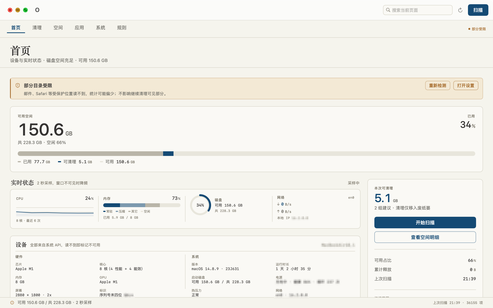
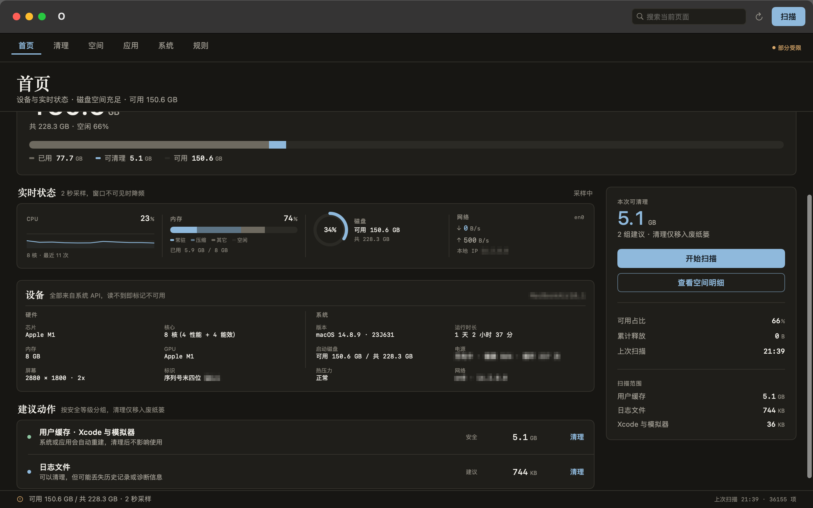
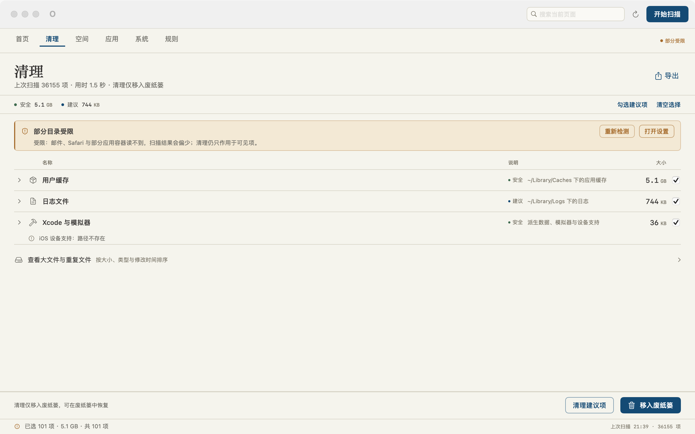
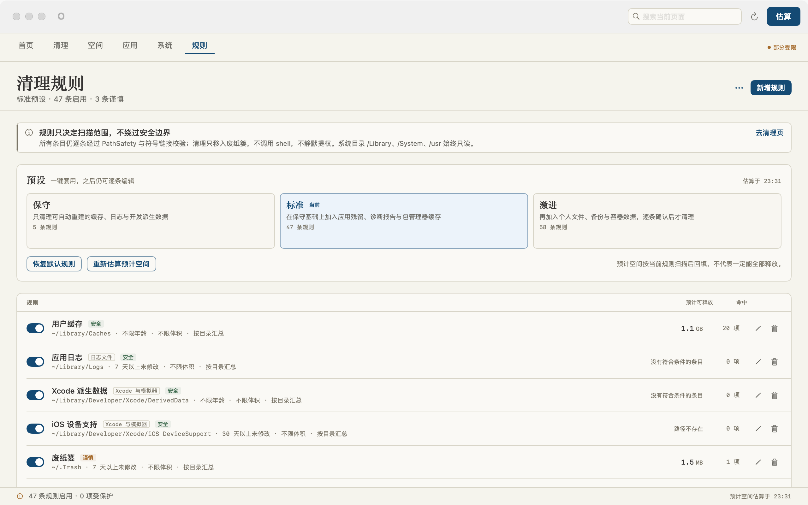
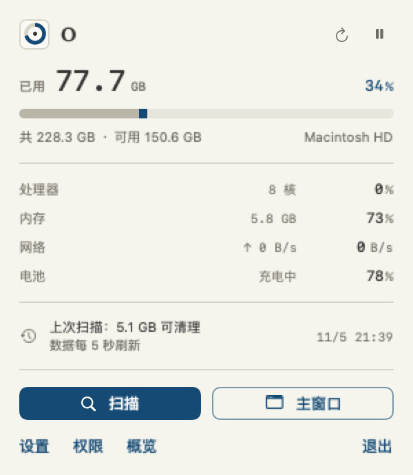

<div align="center">

# O

**A native macOS disk cleaner. Cleanup goes to the Trash by default; the only permanent action is emptying the Trash itself, and it asks first.**

[English](README.md) · [简体中文](README.zh-CN.md)

[](https://github.com/gascs/O/releases/latest)
[](LICENSE)
[](#requirements)
[](https://github.com/gascs/O/actions/workflows/ci.yml)

</div>

---

O is a disk cleanup and system utility for macOS, built with SwiftUI. It shows what is eating your disk, finds what can be safely freed, and **moves files to the Trash** by default — no shell commands during cleanup, no silent privilege escalation, no telemetry. The single exception is the **Trash** category: emptying it is a permanent deletion and requires an explicit second confirmation.

| Home (light) | Home (dark) |
| --- | --- |
|  |  |

| Cleanup | Rules |
| --- | --- |
|  |  |

> The light screenshot is the current home page; the dark screenshot is a historical capture with a slightly cropped top edge and not every card in the same state. Both are included for the colour comparison only.

## Features

- **Top-bar navigation** — six pages (Home · Clean · Space · Apps · System · Rules) in a compact 46 pt bar with ⌘1–⌘6 shortcuts; never wraps at the 860×600 minimum window.
- **Home dashboard** — chip, cores, memory, GPU, display resolution and scale, last four digits of the serial number; macOS build, uptime, boot volume, battery health and cycle count, thermal pressure, local network interfaces and IP. Live charts (CPU sparkline, segmented memory meter, disk usage ring, network rates) sampled every 2 s, throttled to 10 s when the window is hidden. Every value comes from real system APIs (sysctl / IOKit / Metal / getifaddrs) — unreadable data is shown as *unavailable* with a reason, never faked.
- **Rule-driven cleanup** — scans follow user-editable rules, not hardcoded categories. **14 source categories**: user caches, app logs, Xcode derived data, Trash, large-file scan (Downloads / Documents / Desktop / Movies), app leftovers (Application Support / Containers / Group Containers / Saved Application State / HTTPStorages), diagnostic reports, developer artifacts, package manager caches, Docker, iOS backups, mail attachments, personal files, system cache copies.
- **Rules page** — three presets (**Conservative 5 / Standard 47 / Aggressive 58**), full CRUD per rule, protected path list, per-rule estimated reclaimable space and hit counts back-filled after a real scan. Caution-grade rules require explicit confirmation.
- **First-launch onboarding** — four steps: why permissions are needed, current real probe status, how to grant, and how the rule engine works. Can be skipped and reopened from System › Permissions.
- **Menu bar companion** — template icon (system-tinted), compact panel with disk / CPU / memory / network / battery, synced scan state.
- **M2 design system** — warm paper `#F5F4ED` / warm black `#141318`, ink blue `#144A74` as the only accent, serif headings + SF Pro body + monospaced tabular figures, 1 px hairlines, restrained motion, automatic light/dark.

## Menu bar



The menu bar panel shows disk, CPU, memory, network and battery at a glance, keeps the scan state in sync with the main window, and links straight to scanning, the main window, settings, permissions and the overview.

## Rule engine

| Capability | Detail |
| --- | --- |
| Rule model | name, category, path (with `~` expansion), min age (days), min size (MB), safety grade (safe / suggested / caution), enabled, note, scan mode |
| Validation | every save passes `PathSafety` + rule validation: empty / relative paths, home root, system prefixes, paths outside home, `~/Library` root, symlink escapes (resolved **before** the whitelist check) and protected paths are rejected **with a reason**; duplicate paths within a configuration are rejected; forbidden-path matching is case-insensitive (`~/library` == `~/Library`) |
| Presets | Conservative · Standard · Aggressive, one click, then still fully editable; Aggressive asks twice |
| Import / export | JSON with a metadata envelope (format version, app version, export date); file name carries a timestamp. Import asks **Merge or Replace**: merge keeps existing rules and skips duplicate paths, replace swaps the whole configuration; invalid entries are skipped and reported individually, never silently dropped. Imported rules are downgraded from `safe` to `suggested`, user-file rules are forced to `caution`, and rules pointing at sensitive locations (`~/.ssh`, keychains, Mail / Safari data, `~/Library` root …) are rejected |
| Protected list | paths you add here are never cleaned; import merges lists as a union |
| Estimates | per-rule reclaimable bytes and hit counts come from a real rule scan; nested rule roots are deduplicated so nothing is counted twice |

Scanning is streaming and cancellable: background tasks, 150 ms throttled progress callbacks merged to 100 ms UI updates, ETA estimates, symlink loops and repeated traversal avoided, overlapping cache roots deduplicated, permission-blocked paths recorded as skip reasons instead of errors, and large result sets truncated consistently with `totalBytes` recomputed.

## Supported languages & toolchains

25 cache rules ship in 0.5.0: **21 in the Standard preset** (all `safe`, cleaned after 7 days unless noted) and **4 in the Aggressive preset**. Every path is the real default location on macOS and is validated by `PathSafety` / `RuleValidator` like any other rule.

| Toolchain | Cache path | Grade | Preset |
| --- | --- | --- | --- |
| SwiftPM | `~/Library/Caches/org.swift.swiftpm` | safe | Standard |
| Deno | `~/Library/Caches/deno` | safe | Standard |
| Bun | `~/.bun/install/cache` | safe | Standard |
| uv (Python) | `~/Library/Caches/uv` | safe | Standard |
| Poetry | `~/Library/Caches/pypoetry` | safe | Standard |
| RubyGems | `~/.gem` | safe | Standard |
| Bundler | `~/.bundle/cache` | safe | Standard |
| Hex (Elixir) | `~/.hex` | safe | Standard |
| Cabal (Haskell) | `~/.cabal/packages` | safe | Standard |
| Stack (Haskell) | `~/.stack` | safe | Standard (30 days) |
| opam (OCaml) | `~/.opam/download-cache` | safe | Standard |
| NuGet (.NET) | `~/.nuget/packages` | safe | Standard (30 days) |
| Dart pub | `~/.pub-cache` | safe | Standard |
| Bazel | `~/.cache/bazel` | safe | Standard |
| Zig | `~/.cache/zig` | safe | Standard |
| Conan (C/C++) | `~/.conan2/p` | safe | Standard |
| Ivy (Java) | `~/.ivy2/cache` | safe | Standard |
| node-gyp | `~/Library/Caches/node-gyp` | safe | Standard |
| Electron | `~/Library/Caches/electron` | safe | Standard |
| Carthage | `~/Library/Caches/org.carthage.CarthageKit` | safe | Standard |
| JetBrains IDEs | `~/Library/Caches/JetBrains` | safe | Standard |
| Go modules | `~/go/pkg/mod` | caution | Aggressive (30 days) |
| VS Code cache data | `~/Library/Application Support/Code/CachedData` | suggested | Aggressive (30 days) |
| Flutter pub cache | `~/.flutter/pub` | caution | Aggressive (30 days) |
| Conda packages | `~/opt/anaconda3/pkgs` | caution | Aggressive (30 days, ≥ 50 MB) |

The npm / yarn / pnpm / pip / Homebrew / Go build / Cargo / Gradle / Maven / CocoaPods caches are covered by the existing package-manager rules from 0.4.x; Xcode derived data and simulators stay in their own category. Additions are welcome — see [CONTRIBUTING.md](CONTRIBUTING.md) for the rule checklist.

## Performance & algorithms

0.5.0 reworks the hot paths so the UI stays responsive while disks are being scanned:

- **Off the main thread** — disk / network / IOKit sampling for the overview (every 2 s) and the menu bar (every 5 s) runs in the background; both share one sampler, so there is no duplicated polling loop.
- **History decode cache** — the overview no longer decodes the full history JSON on every tick; the latest summary is cached and re-decoded only when the underlying store changes.
- **Generation guards** — scans, cleanups and the background cleanable estimate are tagged with a generation; a cancelled task's late callback can no longer overwrite a newer task's progress or report, and the estimate never clobbers a user-initiated scan.
- **Top-N selection** — large-file and duplicate results are collected with bounded insertion (`O(n·log k)`) instead of sorting everything, while totals are still kept for the UI.
- **Stable sort** — the large-file sort comparator returns a legal result for equal elements (previously `descending ? !result : result`), with path as the explicit tie-breaker.
- **Incremental lists** — progress is coalesced to a low-frequency main-thread refresh, and scanning lists update by diff/append instead of rebuilding the whole array each tick.
- **Consistent truncation and dedupe** — overlapping cache roots are skipped when a more specific root already covers them, and truncated result sets recompute `totalBytes` so the reported numbers match the list.

## Keyboard shortcuts

| Shortcut | Action |
| --- | --- |
| `⌘1 … ⌘6` | Home / Clean / Space / Apps / System / Rules |
| `⇧⌘R` | Start scan |
| `⌘⌫` | Clean selected items |
| `⇧⌘E` | Export report |
| `⌘F` | Focus search |
| `⌘R` | Refresh current page |
| `⌘,` | Open settings |

## Requirements

- macOS 13 Ventura or later (developed and tested on macOS 13 / 14 / 15).
- Apple Silicon (arm64) or Intel (x86_64) — the released DMG is a **universal** binary.
- No external dependencies, no package manager, no admin password for normal cleanup.

## Install

**From DMG** — grab `O-0.5.0.dmg` from [Releases](https://github.com/gascs/O/releases/latest), verify it, then open it and drag **O** into Applications:

```bash
# both files in the same directory:
shasum -a 256 -c O-0.5.0.dmg.sha256
# or print the digest and compare it with the release page:
shasum -a 256 O-0.5.0.dmg
```

The DMG contains `O.app`, an `Applications` shortcut and the project **LICENSE**.

First launch on macOS 13 / 14 / 15 (the build is ad-hoc signed and not notarized, so Gatekeeper will ask once):

1. **System Settings › Privacy & Security › Security** — after the blocked prompt, click **Open Anyway**, then confirm **Open**.
2. Or in Finder, right-click **O.app** › **Open** › **Open** (instead of double-clicking).
3. If it is still blocked: `xattr -dr com.apple.quarantine /Applications/O.app`, then open again.

**From source** — open `Package.swift` in Xcode (scheme `O`, ⌘R to run, ⌘U to test), or:

```bash
bash build_app.sh
open .build/app/O.app
```

## Build & test

Requires macOS 13+ and either full Xcode or the Command Line Tools (`Package.swift` uses `swift-tools-version: 5.9`, Swift 5 language mode).

```bash
bash doctor.sh        # read-only environment check, exits non-zero on any problem
bash build_app.sh     # release build → .build/app/O.app (universal when possible)
bash run_tests.sh     # app build + XCTest + SelfTest, reported separately
bash build_dmg.sh     # → dist/O-<version>.dmg + .dmg.sha256
```

- **Version single source** — `VERSION` is the only place to edit. `build_app.sh`, `build_dmg.sh` and `doctor.sh` fail fast if `VERSION`, `Info.plist` (`CFBundleShortVersionString`) and `Components.swift`'s `AppInfo.fallbackVersion` disagree.
- **XCTest** — a test suite across path safety, scanner behavior, trash service, rules (presets, validation, persistence, JSON round-trip, lenient import, merge dedupe, scanner filters), duplicates, launch items, window close behavior and single instance. The suite is sandbox-safe: tests build a temporary home instead of writing to your real `$HOME`.
- **SelfTest** — a XCTest-free assertion suite (run without Xcode), including a **real** trash round-trip (create a temp file → trash it → verify → remove the test artifact). Run test counts are printed by `run_tests.sh` and deliberately not hardcoded in this README.
- **CI** — GitHub Actions (`macOS 14`) runs both suites and the app build on every push / PR and uploads the `.app`; on `v*` tags it additionally builds the DMG and uploads it with its SHA-256 file as a workflow artifact. Releases themselves are cut deliberately (curated notes), not by the workflow.

Built-in diagnostics, no screen-recording permission needed:

```bash
.build/app/O.app/Contents/MacOS/O --ui-audit         # offscreen 2x PNG of every page, light & dark
.build/app/O.app/Contents/MacOS/O --lifecycle-audit  # close-window residency & window reuse
```

## Safety model

- **Trash first, by default.** Ordinary cleanup calls `trashItem`; there is no `rm` and no shell command involved in scanning or cleaning.
- **The one permanent action is explicit.** The **Trash** category empties items permanently — the confirmation dialog says “permanently delete, not recoverable”, and `CleanReport` reports `movedBytes` (moved to Trash) and `freedBytes` (permanently deleted) separately so the numbers cannot be confused.
- **Path whitelist.** System prefixes are rejected before anything is scanned or cleaned; symlinks are resolved and re-checked against the forbidden / protected lists in a case-insensitive way before the “still inside home” shortcut, so a symlink cannot escape the whitelist.
- **No silent privilege escalation.** The app requests nothing; permission gaps degrade features with an explanation instead of erroring.
- **No shell commands during cleanup.** The only process launch is the system `/usr/bin/open -n` used by `PermissionCenter` to restart the app after a permission change; no user-supplied or third-party command is ever executed.
- **No data leaves the machine.** Device info is read-only and local; no network calls, no telemetry.
- **Integrity on release.** DMG ships with a SHA-256 file, the app bundle carries the LICENSE, and the version in the bundle is checked against `VERSION` at build time.

## Limitations

- Without Full Disk Access, `~/.Trash`, `~/Library/Mail`, Safari data and similar protected locations are reported as restricted rather than counted.
- Emptying the Trash category is irreversible by design — use the preview list before confirming.
- The disk trend chart needs multiple days of samples to become meaningful.
- Duplicate detection is SHA-256 based; it does not find visually similar media.
- The app icon is warm-paper light; macOS icons do not auto-switch in dark mode.
- Chinese UI only for now; localization files are on the roadmap.
- Ad-hoc signed and not notarized: fine for personal and small-team use; public distribution needs Developer ID + notarization. See [CONTRIBUTING.md](CONTRIBUTING.md).

## Contributing & security

- [CONTRIBUTING.md](CONTRIBUTING.md) — build / test / rule / screenshot / PR workflow.
- [SECURITY.md](SECURITY.md) — private vulnerability reporting and the threat model (symlink escape, rule import, permission prompts, release integrity).
- [CODE_OF_CONDUCT.md](CODE_OF_CONDUCT.md) — Contributor Covenant 2.1.
- [CHANGELOG.md](CHANGELOG.md) — release history (Keep a Changelog).

## License

[MIT](LICENSE) © O Project

**Disclaimer** — O is a disk utility. Even though ordinary cleanup is trash-only, emptying the Trash category is permanent; always review the confirmation dialog and the preview list before cleaning. The authors are not responsible for data loss.
