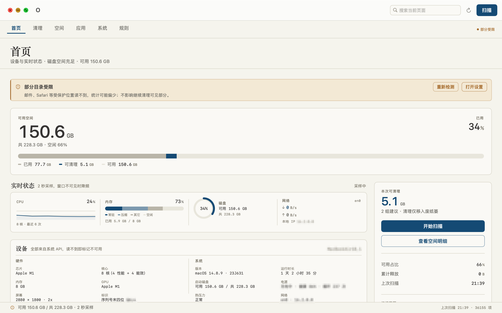
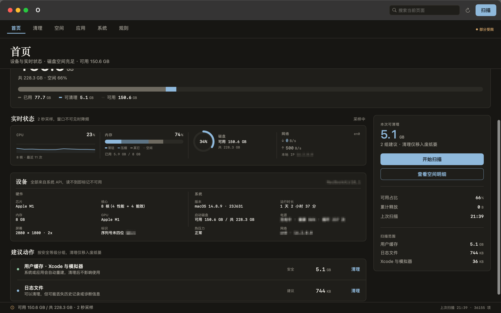
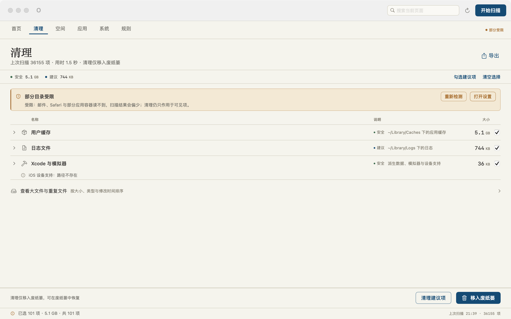
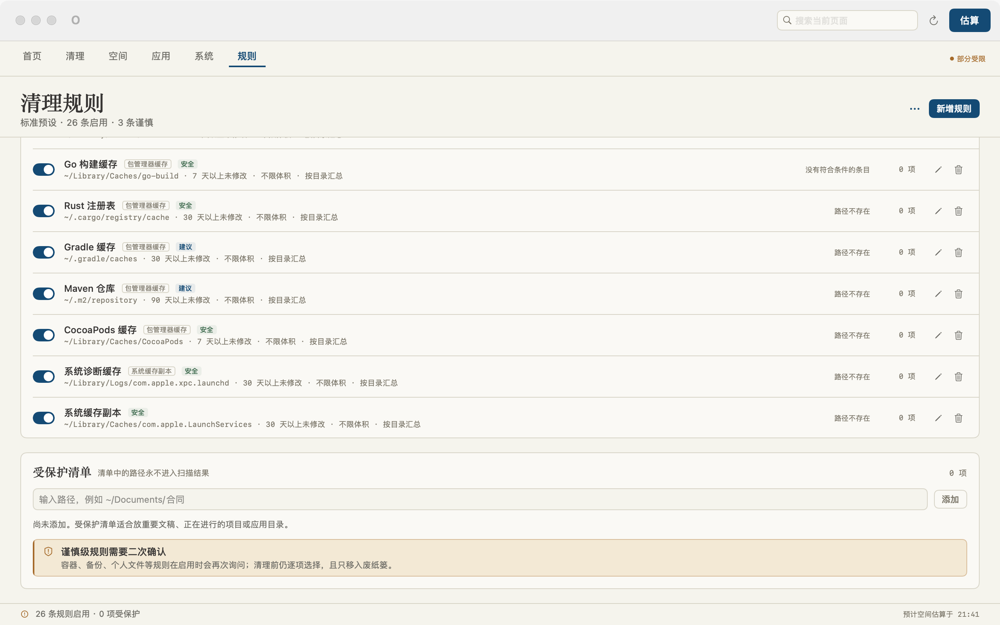
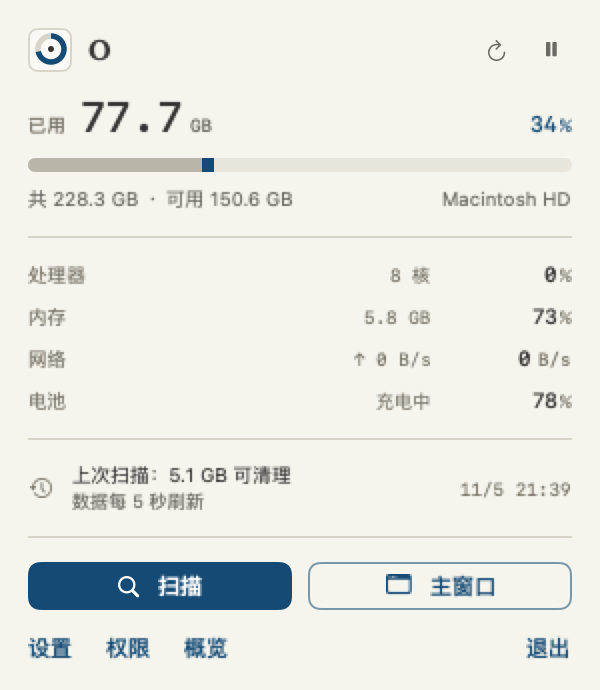

<div align="center">

# O

**一款「从不删除」的原生 macOS 磁盘清理工具 —— 所有清理都只移入废纸篓。**

[English](README.md) · [简体中文](README.zh-CN.md)

[](LICENSE)
[](#)
[](#)
[](#构建与测试)

</div>

---

O 是一个用 SwiftUI 编写的 macOS 磁盘清理与系统工具：看清磁盘被什么占用、找出可以安全释放的空间，并且**只把文件移入废纸篓** —— 不做永久删除、不调用 shell、不静默提权。

| 首页（浅色） | 首页（深色） |
| --- | --- |
|  |  |

| 清理 | 规则 |
| --- | --- |
|  |  |

## 功能

- **顶部导航** —— 六页（首页 · 清理 · 空间 · 应用 · 系统 · 规则）平铺在 46pt 紧凑导航条，⌘1–⌘6 直达；860×600 最小窗口下不换行不截断。
- **首页** —— 芯片、核心数、内存、GPU、屏幕分辨率与缩放、序列号末四位；macOS 版本与构建号、运行时长、启动磁盘、电池健康与循环次数、热压力、本地网络接口与 IP。实时图表（CPU 折线、内存分段条、磁盘占用环、网络上下行速率）2 秒采样，窗口隐藏时降为 10 秒。所有数值来自真实系统 API（sysctl / IOKit / Metal / getifaddrs），读不到就显示「不可用」并说明原因，绝不伪造。
- **规则驱动的清理** —— 扫描按用户可编辑的规则执行，而不是写死的分类。14 类来源：用户缓存、应用日志、Xcode 派生数据、废纸篓、应用残留（Application Support / Containers / Group Containers / Saved Application State / HTTPStorages）、诊断报告、开发者产物、包管理器缓存（npm / yarn / pnpm / pip / Homebrew / Go / Cargo / Gradle / Maven / CocoaPods）、Docker、iOS 备份、邮件附件、个人大文件、系统缓存。
- **规则页** —— 三档预设（保守 5 条 / 标准 26 条 / 激进 33 条），逐条增删改停，受保护路径清单，扫描后回填每条规则的预计可释放空间与命中数。谨慎级规则启用需二次确认。
- **首次启动引导** —— 四步：为什么需要权限、当前真实探测状态、如何去授权、清理规则引擎怎么用。可跳过，之后在 系统 › 权限 重新打开。
- **菜单栏常驻** —— 模板图标（系统按外观着色），紧凑面板展示磁盘 / CPU / 内存 / 网络 / 电池，扫描状态与主窗口同步。
- **M2 设计系统** —— 暖纸 `#F5F4ED` / 暖黑 `#141318`，墨蓝 `#144A74` 唯一强调色，衬线标题 + SF Pro 正文 + 等宽 tabular 数字，1px 细线，克制动效，自动跟随深浅色。

## 菜单栏



菜单栏面板一眼展示磁盘、CPU、内存、网络与电池，扫描状态与主窗口同步，并可直接进入扫描、主窗口、设置、权限与概览。

## 规则引擎

| 能力 | 说明 |
| --- | --- |
| 规则模型 | 名称、类别、路径（支持 `~` 展开）、最小年龄（天）、最小体积（MB）、安全等级（安全 / 建议 / 谨慎）、是否启用、说明、扫描方式 |
| 校验规范 | 每次保存都经过 `PathSafety` 与规则校验：空路径、相对路径、主目录本身、系统前缀、主目录外、`~/Library` 根、符号链接逃逸、受保护路径一律拒绝并**给出原因**；同一配置内不允许重复路径 |
| 预设 | 保守 · 标准 · 激进一键套用，之后仍可逐条编辑；激进预设套用前二次确认 |
| 导入 / 导出 | JSON 带元数据信封（格式版本、应用版本、导出时间），文件名带时间戳。导入时可选**合并到现有规则 / 替换全部**：合并保留现有规则并跳过同路径条目，替换则整套换掉；非法条目逐条跳过并报告原因，绝不静默丢弃 |
| 受保护清单 | 加入的路径永不清理；导入时保护清单按并集合并 |
| 预计空间 | 每条规则的可释放体积与命中数来自一次真实规则扫描；父子规则根嵌套去重，不会重复计量 |

扫描为后台流式执行：可取消，进度 150ms 节流回调、界面 100ms 合并刷新，显示 ETA，避免符号链接环与重复遍历，权限不足的路径记录跳过原因而不是报错。

## 快捷键

| 快捷键 | 作用 |
| --- | --- |
| `⌘1 … ⌘6` | 首页 / 清理 / 空间 / 应用 / 系统 / 规则 |
| `⇧⌘R` | 开始扫描 |
| `⌘⌫` | 清理所选项 |
| `⇧⌘E` | 导出报告 |
| `⌘F` | 聚焦搜索 |
| `⌘R` | 刷新当前页 |
| `⌘,` | 打开设置 |

## 安装

**DMG 方式** —— 本地打包后打开，把 **O** 拖入 Applications：

```bash
bash build_dmg.sh     # → dist/O-<版本号>.dmg
```

**源码方式** —— 用 Xcode 打开 `Package.swift`（选 O scheme，⌘R 运行，⌘U 测试），或：

```bash
bash build_app.sh
open .build/app/O.app
```

> DMG 为 ad-hoc 签名：首次打开需在「系统设置 › 隐私与安全性」点击「仍要打开」。面向大众分发建议配置 Developer ID 签名并公证。

## 构建与测试

需要 macOS 13+、Xcode 16.2（或 Swift 6.0 工具链）。

```bash
bash build_app.sh     # release 构建，0 警告，打包 .app 与图标
bash run_tests.sh     # 两套测试分别报告
```

- **XCTest**：78 个用例，0 失败 —— 路径安全、扫描器行为、废纸篓服务、规则（预设、校验、持久化、JSON 往返、宽松导入、合并去重、扫描过滤）、重复文件、启动项、关窗行为、单实例。
- **SelfTest**：204 项断言，0 失败 —— 不依赖 XCTest 的等价自检，包含一次**真实**的移入废纸篓往返（创建临时文件 → 移入废纸篓 → 校验 → 清理测试产物）。

内置诊断，无需屏幕录制权限：

```bash
.build/app/O.app/Contents/MacOS/O --ui-audit         # 每页离屏 2x PNG，浅 / 深两套
.build/app/O.app/Contents/MacOS/O --lifecycle-audit  # 关窗驻留与窗口复用
```

## 安全边界

- **只进废纸篓。** 每个清理动作都调用 `trashItem`。没有 `rm`，没有 shell，没有绕过。
- **路径白名单。** 系统前缀在扫描与清理之前就被拒绝；符号链接逃逸会被检测。
- **不静默提权。** 应用不主动索取权限；权限缺失时功能降级并解释，而不是报错。
- **数据不出本机。** 设备信息只读且本地化：无网络上报、无遥测。
- **设计上可撤销。** 没有任何永久删除；废纸篓就是你的后悔药。

## 已知限制

- 未授权完全磁盘访问时，`~/.Trash`、`~/Library/Mail`、Safari 数据等受保护位置会如实显示受限，而不是计入统计。
- 磁盘趋势需要连续多天的采样点才有完整曲线。
- 重复文件查找基于 SHA-256，不做视觉相似媒体匹配。
- 应用图标为暖纸浅色；macOS 图标不随深色模式自动切换。
- 界面当前为中文；本地化资源在计划中。
- ad-hoc 签名适合本机使用；公开发布需要 Developer ID 签名与公证。

## 许可证

[MIT](LICENSE) © O Project

**免责声明** —— O 是磁盘工具。尽管所有清理都只进废纸篓，执行前仍请查看确认弹窗中的路径列表。作者不对数据丢失承担责任。
